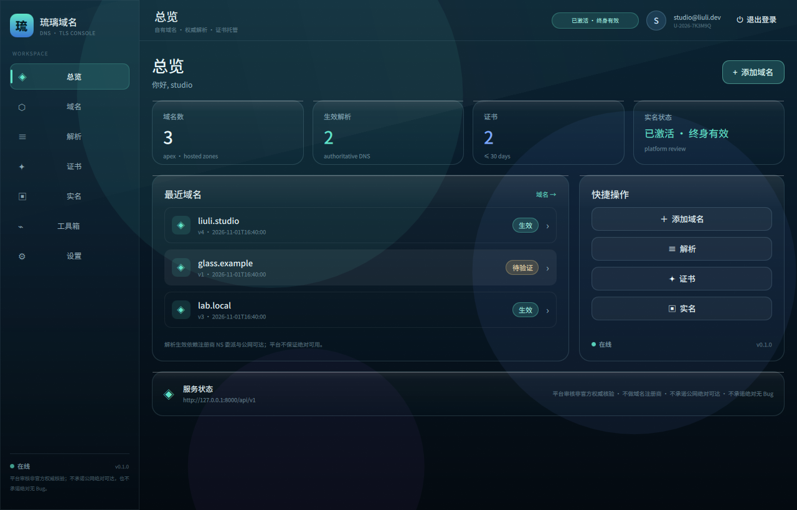
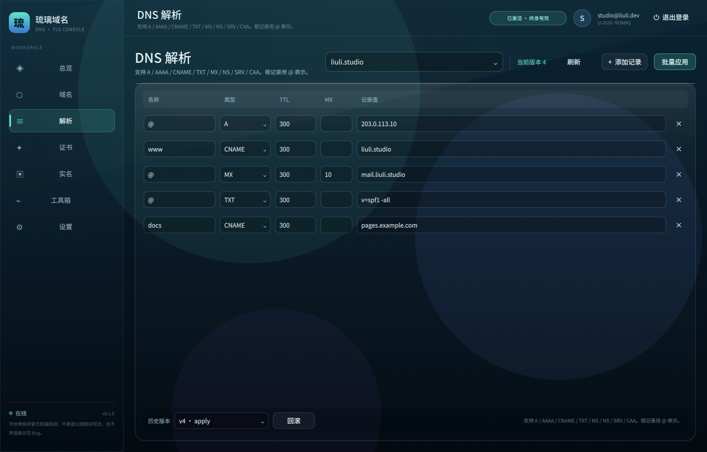

# 琉璃域名 LiuliDNS — 桌面客户端

这是 LiuliDNS 的 **PySide6 + QML Windows/Linux 桌面客户端**开源仓库。服务端实现、部署配置、数据库结构与运营密钥**不在本仓库**；客户端只通过 HTTPS 调用用户配置的 API，不包含任何后端令牌、证书私钥或用户数据。

> 本客户端用于管理**用户已在注册商处注册并拥有控制权的域名**。它不是域名注册商；公网访问取决于用户的域名、NS 委派、公网 IP 和可达端口，不承诺绝对可达。

## 功能

- 玻璃/琉璃质感界面、毛细孔噪点纹理、卡片高光、按钮 hover/水波纹、页面淡入过渡；可切换原生界面。
- 简体中文 / English / 繁體中文。
- 可跳过的三步新手引导，提示创建过程中不要关闭设备或断网（不写“一切作废”）。
- 登录/注册、邮箱验证、算术人机验证、忘记密码。
- 总览、域名、解析、证书、实名、工具箱、设置。
- 域名添加与 NS/TXT 验证指引；A/AAAA/CNAME/TXT/MX 等记录编辑、批量应用、历史回滚。
- 证书上传/替换（multipart，私钥只提交给服务端，不在客户端持久化）、到期展示。
- 本地实验服务（127.0.0.1，自定义端口）、端口检测、DNS 查询、证书解析、hosts 提示、防火墙 UAC 放行。
- 脱敏崩溃日志，可一键复制到剪贴板；设置页 GitHub 图标只跳转本开源仓库。

## 截图




更多截图在 `docs/screenshots/`。

## 运行

```bash
python3 -m venv .venv
.venv/bin/pip install -r client/requirements.txt
.venv/bin/python -m client.app.main
```

无后端时可用演示模式：

```bash
.venv/bin/python -m client.app.main --demo
```

Linux 无显示器环境可用 `xvfb-run -a -s "-screen 0 1440x900x24" .venv/bin/python -m client.app.main --demo --screenshot /tmp/shots`。

## API 配置

设置页填写 API 根地址，例如 `https://api.example.com/api/v1`。客户端不硬编码任何令牌/密钥；登录后的 access/refresh token 由 `keyring`（Windows Credential Locker）保存，失败时仅保存在进程内存。生产环境必须使用 HTTPS；HTTP 只用于本机调试，界面会给出警告。

## 构建

Windows 构建脚本在私有发布流水线中维护；本仓库不包含签名私钥、PFX 或生产部署配置。开发者可在 Windows 上用 PyInstaller 打包 `packaging/entry.py`，并把 `client/app/qml` 与 `client/resources` 作为数据目录；或直接运行源码。

## 安全边界

- 客户端不执行防杀进程、对抗用户控制、静默提权；防火墙操作需要用户确认 UAC。
- 崩溃日志会脱敏邮箱、令牌、密码、私钥、证件号等模式；不会上传到第三方。
- 限流与人机验证只能缓解滥用，不承诺完全防住 DDoS/CC。
- 平台实名审核是平台人工审核，不是官方权威核验。
- 本项目按 MIT 许可；托管服务适用 EULA（见 `LICENSE-EULA`）。

## 文档

- [设计说明](docs/01-design.md)
- [安全与能力边界](docs/04-security-boundaries.md)
- [API 摘要](docs/05-api.md)

## License

客户端代码：MIT（`LICENSE`）。托管服务与品牌：LiuliDNS EULA（`LICENSE-EULA`）。
